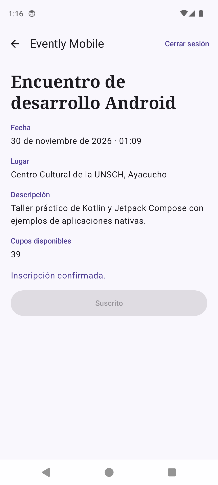

# Evently Mobile · Nivel Básico

Aplicación Android para descubrir eventos, consultar su disponibilidad e inscribirse. El catálogo y las inscripciones consultadas quedan disponibles en el dispositivo aunque se pierda la conexión.

El módulo Android, el backend del curso y su infraestructura viven en este repositorio Git. El alcance de entrega corresponde a los requisitos comunes y a Evently Básico del [documento oficial](https://github.com/jorgesandovalflores/especializacion-mobile/blob/main/native-android/alcance_proyectos_android.md).

## Ejecutar

La API local usa el contrato original de GitHub. El APK actual exige el campo `availableSpots`, que ese contrato omite, por lo que falla la descarga del catálogo desde esta API.

El entorno de desarrollo requiere JDK 21, Android SDK Platform 37 y Docker Desktop con Compose v2. El APK se instala desde Android 10 (API 29).

1. Inicia Docker Desktop. Desde la raíz, ejecuta `& .\infra-evently\start-local.ps1`. Compose inicia MySQL y Redis, aplica las migraciones y arranca la API. El entorno de desarrollo incluye cuentas y eventos de ejemplo.
2. Comprueba el [catálogo REST](http://localhost:3001/api/events) o abre [Swagger](http://localhost:3001/api/docs).
3. Abre la raíz en Android Studio y ejecuta el módulo `app` en un emulador. Puedes crear tu cuenta en la pantalla de registro o usar la cuenta `attendee` de [los datos de ejemplo del curso](backend-evently/src/core/database/seed/data/users.json).

```powershell
.\gradlew.bat :app:testDebugUnitTest :app:assembleDebug
.\gradlew.bat :app:installDebug
```

La versión de depuración usa `http://10.0.2.2:3001/api/` en el emulador. Para un dispositivo físico conectado por USB, ejecuta `adb reverse tcp:3001 tcp:3001` y compila con `-PeventlyApiUrl=http://127.0.0.1:3001/api/`. Para una API remota, configura su URL HTTPS con la misma propiedad. El APK de depuración se genera en `app/build/outputs/apk/debug/app-debug.apk`.

## Requisitos

| Código | Implementación |
| --- | --- |
| EB-01, EB-02 | Registro e inicio con validación local. La pantalla de arranque comprueba la sesión cifrada antes de abrir el catálogo o el login. |
| EB-03, EB-04 | Catálogo y detalle observados de Room. El detalle recibe el ID y muestra fecha, lugar, descripción y disponibilidad del backend. |
| EB-05, EB-06 | Inscripción nativa con confirmación, disponibilidad actualizada y listado personal persistente. |
| EB-07, C-01 a C-03 | Indicadores de carga, errores traducidos, reintento y lectura de la caché sin conexión. |
| EB-08, S-03 | El cierre limpia la sesión y las tablas locales, incluso sin red. |
| C-04, C-05 | Navigation Compose y ViewModels por entrada de navegación preservan destino, formularios y cargas durante la rotación. |
| S-01, S-02 | AES-GCM y Android Keystore. OkHttp adjunta el access token y limita a un reintento por petición tras renovar. |
| S-04, S-05 | Las claves del entorno se generan localmente y los secretos se excluyen de Git. El flujo Básico usa el permiso normal de Internet. |
| EB-09, Q-01 | Pruebas unitarias con fakes para listado, inscripción y el ViewModel del catálogo. |
| Q-02 a Q-04 | Documentación y capturas en este repositorio, commits descriptivos y APK de depuración instalable. |

## Arquitectura y verificación

- [Requisitos funcionales y reglas de inscripción](docs/requisitos.md)
- [Arquitectura y comunicación entre capas](docs/arquitectura.md)
- [Integración REST, persistencia y sesión](docs/integraciones.md)
- [Flujo de demostración y evidencias](docs/verificacion.md)



El cliente usa Kotlin, Jetpack Compose Material 3, Navigation Compose, Hilt, ViewModel, Coroutines, Flow, Room, Retrofit, Moshi, OkHttp y JUnit.

## Documentos del curso

- [Alcance de los proyectos Android](docs/curso/alcance_proyectos_android.md)
- [Plan de estudio · Desarrollo Móvil Nativo para Android](docs/curso/Plan%20de%20estudio%20-%20Curso%20desarrollo%20M%C3%B3vil%20Nativo%20para%20Android.pdf)
- [Proyecto final · Desarrollo Móvil Nativo para Android](docs/curso/Proyecto%20Final%20-%20Curso%20Desarrollo%20M%C3%B3vil%20Nativo%20para%20Android.pdf)
