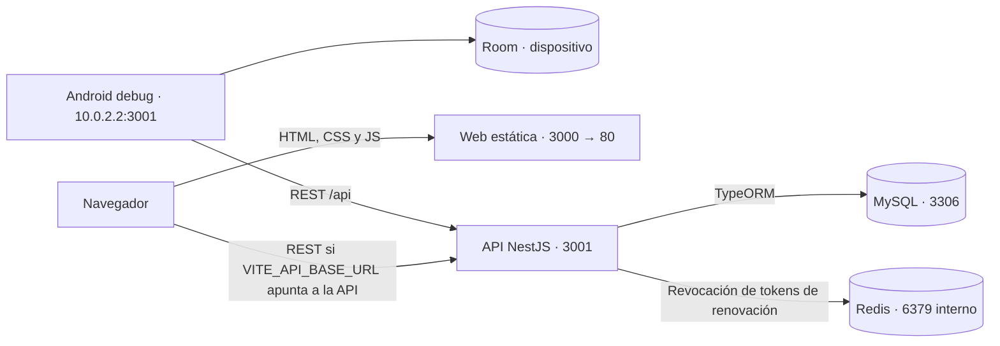
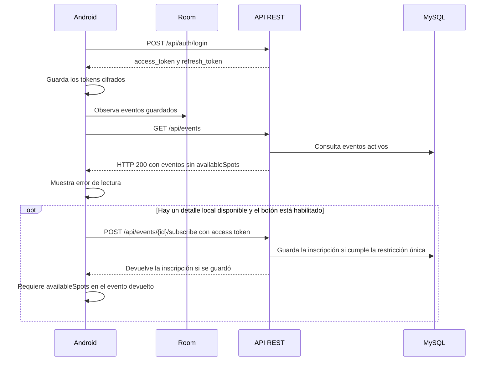

# Evently Mobile · Proyecto final · Nivel Básico

Evently Mobile es un cliente Android para asistentes a eventos. El repositorio contiene el módulo Android, la API REST del curso, un cliente web Vue y el entorno Docker. Android implementa registro, sesión, navegación y caché local. Las pantallas y las consultas de catálogo, detalle e inscripción existen en el cliente.

> **Estado del flujo principal.** La API incluida devuelve eventos sin `availableSpots`. Android exige ese campo y falla al leer el catálogo cuando la respuesta contiene eventos. Con la caché vacía, el flujo se detiene antes de abrir el detalle desde la lista. [Estado de EB-01 a EB-09](docs/requisitos.md)

## Contenido

1. [Componentes](#1-componentes)
2. [Arquitectura](#2-arquitectura)
3. [Flujo de consulta e inscripción](#3-flujo-de-consulta-e-inscripción)
4. [Datos de desarrollo](#4-datos-de-desarrollo)
5. [Puesta en marcha](#5-puesta-en-marcha)
6. [Configuración local](#6-configuración-local)
7. [Estructura de carpetas](#7-estructura-de-carpetas)
8. [Documentación por módulo](#8-documentación-por-módulo)

## 1. Componentes

| Carpeta | Responsabilidad | Tecnologías principales |
| --- | --- | --- |
| [`app`](app/README.md) | Cliente Android con sesión cifrada y caché de eventos | Kotlin, Compose, Hilt, Retrofit, OkHttp, Room |
| [`backend-evently`](backend-evently/README.md) | API REST de sesión, eventos e inscripciones | NestJS, JWT, TypeORM, MySQL, Redis |
| [`web-evently`](web-evently/README.md) | Cliente web del curso | Vue 3, Vite, Pinia, Axios, Nginx |
| [`infra-evently`](infra-evently/README.md) | Servicios y red Docker del entorno local | Docker Compose, MySQL 8.0 y Redis 8.2 |
| [`docs`](docs/README.md) | Guía Android, requisitos y material del curso | Markdown, Mermaid y capturas |

## 2. Arquitectura



Android observa Room para presentar eventos y suscripciones. El servidor persiste la relación entre usuario y evento en MySQL. El navegador recibe los archivos estáticos de Nginx y Axios usa la URL REST configurada al construir la web. [Configuración y comportamiento de la web](web-evently/README.md)

## 3. Flujo de consulta e inscripción



Con la caché vacía, el error del catálogo impide abrir el detalle y alcanzar el paso de inscripción. Con un detalle disponible, el botón usa el ID del evento y el access token. La confirmación visual depende de que Android pueda leer la respuesta y guardarla en Room.

[Diagramas de Android](docs/README.md#5-funcionalidades-y-comunicación-entre-capas) · [Contrato REST e inscripción](backend-evently/README.md#42-eventos-e-inscripciones)

## 4. Datos de desarrollo

En Docker, el arranque en modo `development` ejecuta el seed con eventos de ejemplo después de las migraciones. Para verificar el acceso de Android, usa la cuenta `attendee` del archivo de seed. Reiniciar el backend conserva los registros existentes. [Datos de acceso de desarrollo](backend-evently/src/core/database/seed/data/users.json)

## 5. Puesta en marcha

1. Con Docker Desktop iniciado, ejecuta desde la raíz `& .\infra-evently\start-local.ps1`.
2. Comprueba el catálogo REST en el puerto 3001 y abre Swagger para consultar las rutas.
3. Abre esta raíz en Android Studio con JDK 21 para Gradle y SDK Platform 37. Ejecuta `app` en un emulador API 29 o superior. En depuración, el emulador apunta a `http://10.0.2.2:3001/api/`.

```powershell
.\gradlew.bat :app:testDebugUnitTest :app:assembleDebug
.\gradlew.bat :app:installDebug
```

El APK se genera en `app/build/outputs/apk/debug/app-debug.apk`. Las tres pruebas JVM usan fakes para listado, inscripción y reintento del ViewModel. [Swagger local](http://localhost:3001/api/docs) · [Catálogo REST](http://localhost:3001/api/events) · [Arranque Android y verificación](docs/README.md#6-ejecutar-probar-y-mantener)

## 6. Configuración local

| Configuración | Uso |
| --- | --- |
| `infra-evently/.env` | Variables de Compose y claves locales. El script de PowerShell lo genera desde la plantilla si hace falta. |
| `local.properties` | Ruta del SDK que configura Android Studio. |
| Propiedad Gradle `eventlyApiUrl` | URL base de Android al compilar, incluido el prefijo `/api`. |
| `VITE_API_BASE_URL` | URL REST del navegador. Se resuelve en Vite al ejecutar desarrollo o al compilar. |

[Plantilla de Compose](infra-evently/.env.example) · [Conexión desde un dispositivo físico](docs/README.md#arranque-rápido)

## 7. Estructura de carpetas

```text
appevents/
├── app/                Código, pruebas y recursos Android
├── backend-evently/    API, migraciones y datos de desarrollo
├── web-evently/        Cliente Vue y configuración Nginx
├── infra-evently/     Servicios de Docker Compose y script de inicio
├── docs/               Guía Android, requisitos, capturas y documentos del curso
└── gradle/             Wrapper y catálogo de dependencias
```

## 8. Documentación por módulo

- [Android](docs/README.md) · Capas, navegación, sesión, Room, pruebas y diagnóstico.
- [Backend](backend-evently/README.md) · Módulos, autenticación, contrato REST, errores y persistencia.
- [Web](web-evently/README.md) · Pantallas, sesión, URL REST y publicación estática.
- [Infraestructura](infra-evently/README.md) · Topología, variables, imágenes, puertos y arranque.
- [Requisitos del Básico](docs/requisitos.md) · Alcance y estado actual de cada requisito.

## Referencias del curso

[Evently Básico en el alcance oficial](docs/curso/alcance_proyectos_android.md#44-nivel-básico) · [Plan de estudio](docs/curso/Plan%20de%20estudio%20-%20Curso%20desarrollo%20M%C3%B3vil%20Nativo%20para%20Android.pdf) · [Proyecto final](docs/curso/Proyecto%20Final%20-%20Curso%20Desarrollo%20M%C3%B3vil%20Nativo%20para%20Android.pdf)
