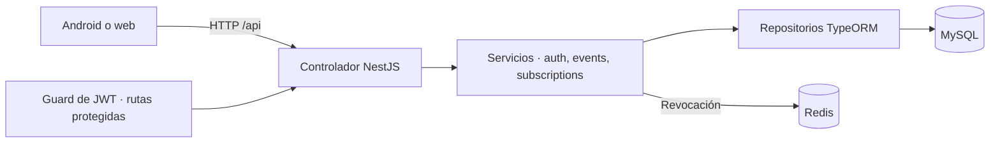
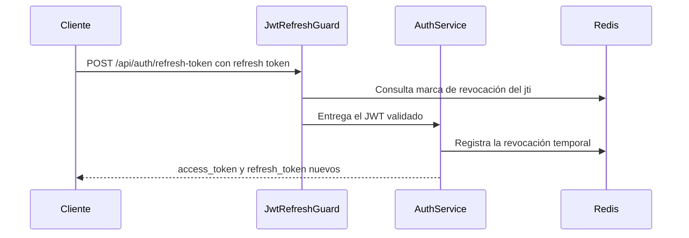
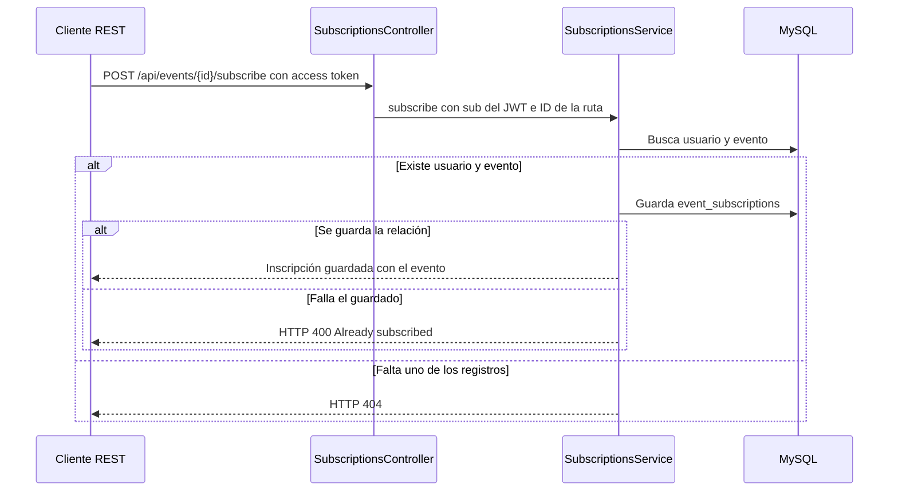

# Backend Evently · API REST

API NestJS que usa Evently Mobile para registro, sesión, catálogo e inscripciones. MySQL guarda los datos del negocio y Redis conserva las marcas de revocación de tokens. El contrato de eventos actual omite `availableSpots`, que Android exige al leer un evento. [Guía de Android](../docs/README.md#32-contrato-rest) · [Infraestructura](../infra-evently/README.md)

## 1. Stack técnico y arquitectura

| Componente | Tecnología | Responsabilidad |
| --- | --- | --- |
| Entrada HTTP | NestJS 11, Helmet y Swagger | Rutas, validación de DTO y documentación en `/api/docs`. |
| Sesión | Passport, JWT y Argon2 | Valida tokens y verifica contraseñas almacenadas como hash. |
| Persistencia | TypeORM 0.3 y MySQL 8.0 | Entidades, repositorios y migraciones. |
| Revocación | ioredis 5 y Redis 8.2 | Guarda marcas temporales de tokens revocados. |
| Compilación | TypeScript 5, Node 22 y pnpm | Genera JavaScript en `dist/`. |



El controlador recibe parámetros y DTO. El servicio ejecuta la operación y usa repositorios TypeORM. En rutas protegidas, el guard verifica el Bearer y coloca el payload en `req.user`. La aplicación ejecuta `ValidationPipe` con transformación y rechazo de propiedades ajenas al DTO. [Arranque NestJS](src/main.ts) · [Guard de acceso](src/core/http/guards/jwt-access.guard.ts)

## 2. Organización del código

```text
backend-evently/
├── src/
│   ├── main.ts                      API, validación global y Swagger
│   ├── app.module.ts                 Configuración e integración de módulos
│   ├── core/
│   │   ├── config/                   HTTP, MySQL, Redis y Swagger
│   │   ├── cache/                    Cliente Redis
│   │   ├── http/                     Guards, roles y tipo de JWT
│   │   ├── cli/                      Procesos de migración y seed
│   │   └── database/                 TypeORM, migraciones y datos de desarrollo
│   └── features/
│       ├── auth/                     Registro, login y renovación
│       ├── users/                    Usuarios y consultas que usa autenticación
│       ├── events/                   Catálogo y detalle
│       └── subscriptions/            Inscripción y lista del usuario
├── Dockerfile
└── entrypoint.sh
```

## 3. Persistencia y arranque

| Entidad | Datos y relaciones |
| --- | --- |
| `User` | Identidad, correo, rol y hash de contraseña. |
| `Event` | Título, descripción, lugar, fecha, estado y referencia al creador. |
| `EventSubscription` | Usuario, evento y fecha de inscripción. La combinación usuario–evento es única en MySQL. |

En Docker, el entrypoint espera a MySQL, ejecuta migraciones pendientes y ejecuta los seeds cuando `NODE_ENV=development`. Después arranca NestJS. El seed conserva cuentas existentes y usa identificadores fijos para los eventos de ejemplo. [Entrypoint](entrypoint.sh) · [Seeds](src/core/database/seed/users-seed.ts) · [Entidad de inscripción](src/features/subscriptions/entities/event-subscription.entity.ts)

## 4. Contrato REST de Evently Básico

El prefijo habitual es `/api`. La tabla muestra las rutas que usa la app Android.

### 4.1 Sesión

| Método y ruta | Entrada | Resultado |
| --- | --- | --- |
| `POST /auth/register` | JSON con `name`, `email`, `password`. La contraseña admite entre 8 y 128 caracteres. | Crea una cuenta y devuelve `user`, `access_token` y `refresh_token`. |
| `POST /auth/login` | JSON con `email` y `password`. | Devuelve la cuenta y ambos tokens con credenciales válidas. |
| `POST /auth/refresh-token` | Refresh token en el encabezado Bearer. | Comprueba que el token no esté revocado, registra su revocación y devuelve un nuevo par. |
| `POST /auth/logout` | Access token en el encabezado Bearer. | Registra en Redis el identificador `jti` recibido. Android envía el refresh token después de borrar su sesión local y ese guard rechaza la petición. |



[Controlador de sesión](src/features/auth/auth.controller.ts) · [Estrategia de renovación](src/features/auth/strategies/jwt-refresh.strategy.ts) · [Servicio de sesión](src/features/auth/auth.service.ts)

### 4.2 Eventos e inscripciones

| Método y ruta | Autorización | Resultado |
| --- | --- | --- |
| `GET /events` | Pública | Hasta 100 eventos activos con fecha vigente, ordenados por fecha. |
| `GET /events/{id}` | Pública | Busca un evento por ID. |
| `POST /events/{id}/subscribe` | Access token | Guarda la relación entre el usuario autenticado y el evento. Acepta el ID en la URL. |
| `GET /me/subscriptions` | Access token | Devuelve las inscripciones del usuario con el evento asociado. |



**Contrato de cupos.** El backend actual devuelve los eventos sin `availableSpots` y la inscripción solo comprueba que existan usuario y evento antes de guardar. Android exige el campo tanto al cargar el catálogo y el detalle como al leer el evento asociado a una inscripción. [Servicio de eventos](src/features/events/events.service.ts) · [Servicio de inscripciones](src/features/subscriptions/subscriptions.service.ts)

## 5. Ejecutar, comprobar y diagnosticar

Desde la raíz, inicia el entorno con el script documentado en infraestructura. Para compilar el backend desde esta carpeta con sus dependencias instaladas, ejecuta `pnpm build`.

```powershell
Invoke-RestMethod 'http://localhost:3001/api/events'
```

| Comprobación | Comportamiento actual |
| --- | --- |
| Login REST de una cuenta del seed | HTTP 201 con el par de tokens. |
| Listado y detalle de eventos de ejemplo | HTTP 200 con eventos sin `availableSpots`. |
| Mis suscripciones con access token | HTTP 200. |
| Inscripción sin access token | HTTP 401. |
| Intento de insertar una inscripción duplicada | La restricción única impide el duplicado. El servicio devuelve HTTP 400. |
| Error de conexión con MySQL durante el arranque | Revisa el estado del contenedor MySQL y los logs de la API. |

[Swagger local](http://localhost:3001/api/docs) · [Cuentas de desarrollo](src/core/database/seed/data/users.json) · [Comandos y diagnóstico de Docker](../infra-evently/README.md#6-diagnóstico)
