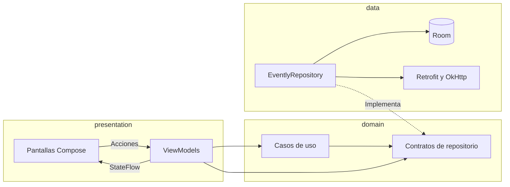
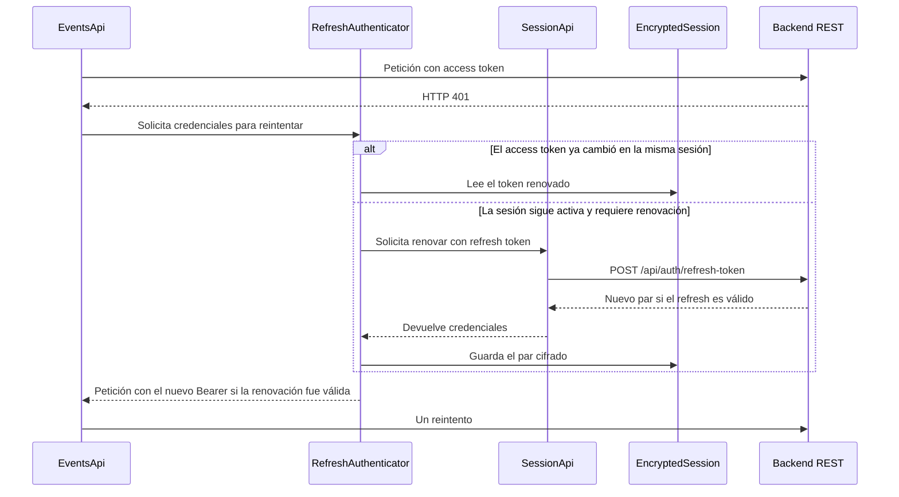
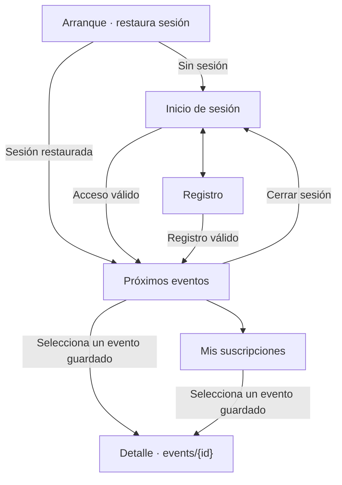
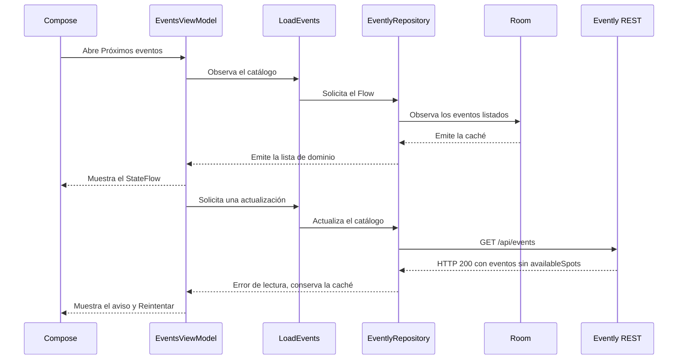
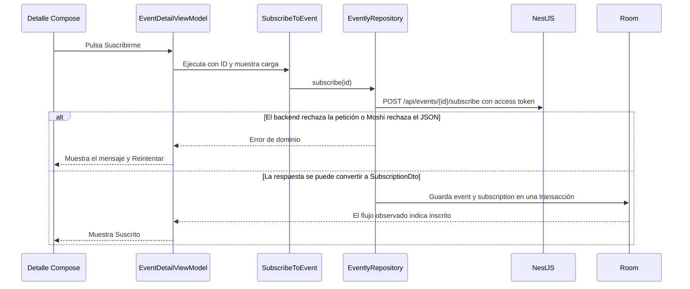
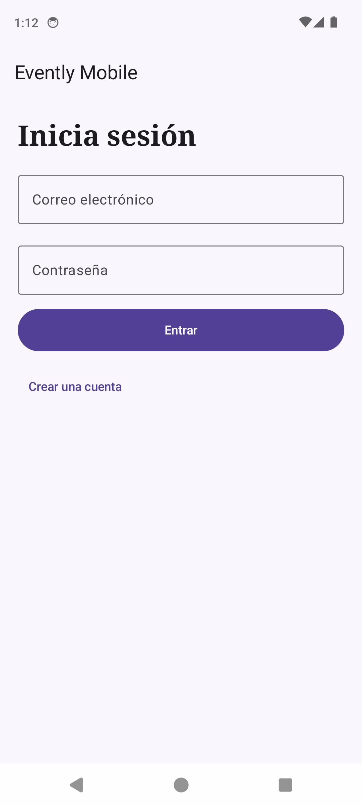

# Evently Mobile · Nivel Básico

Evently Mobile es un cliente Android para asistentes a eventos. Incluye registro, inicio y cierre de sesión, pantallas de eventos e inscripciones, y caché local en Room.

La aplicación Android se comunica por REST con el backend Evently del curso. El alcance funcional corresponde a EB-01 a EB-09. [Requisitos de Evently Básico](requisitos.md) · [Alcance oficial del curso](curso/alcance_proyectos_android.md#44-nivel-básico)

> **Compatibilidad con el backend incluido.** La API original no entrega `availableSpots`, un campo obligatorio en el cliente Android. La app puede iniciar sesión, pero falla al leer los eventos recibidos. El cierre de sesión local funciona. La solicitud de revocación al servidor se rechaza porque Android envía el refresh token y la API original exige el access token.

## 1. Stack técnico y arquitectura

| Área | Tecnología | Versión | Uso en Evently |
| --- | --- | --- | --- |
| Compilación | Android Gradle Plugin y Gradle Wrapper | 9.2.1 y 9.4.1 | Compilan el módulo `app`. Gradle usa un daemon con JDK 21 y la app compila con compatibilidad Java 17. |
| Android | SDK de compilación, objetivo y mínimo | 37, 36 y 29 | La instalación requiere Android 10 o superior. |
| Lenguaje | Kotlin y KSP | 2.2.10 y 2.3.5 | KSP genera código para Hilt, Room y los adaptadores de Moshi. |
| Interfaz | Jetpack Compose y Material 3 | BOM 2024.09.00 | Formularios, listas, detalle y estados de carga y error. |
| Navegación y estado | Navigation Compose y Lifecycle | 2.8.9 y 2.8.7 | Destinos, argumentos de ruta, ViewModels y observación del estado con el ciclo de vida. |
| Inyección | Hilt | 2.60.1 | Provee repositorios, clientes HTTP, base de datos y ViewModels. |
| Red | Retrofit, Moshi y OkHttp | 2.12.0, 1.15.2 y 4.12.0 | Rutas REST, conversión JSON y renovación de tokens. |
| Persistencia | Room | 2.7.0 | Caché de eventos y suscripciones, observada desde la interfaz. |
| Asincronía | Coroutines y Flow | 1.10.2 | Acciones suspendidas y flujos de datos y estado. |
| Seguridad | Android Keystore y AES-256-GCM | API de Android | Cifra los tokens antes de guardarlos en SharedPreferences. |
| Pruebas | JUnit y Coroutines Test | 4.13.2 y 1.10.2 | Pruebas JVM con repositorios falsos. |

[Catálogo de dependencias](../gradle/libs.versions.toml) · [Configuración del módulo Android](../app/build.gradle.kts)

### MVVM y dependencias entre capas

| Capa | Responsabilidad | Componentes |
| --- | --- | --- |
| `presentation` | Recibe acciones, coordina la navegación y presenta el estado. Consume contratos y casos de uso del dominio. | `EventlyApp`, `AuthViewModel`, `EventsViewModel`, `EventDetailViewModel`, `SubscriptionsViewModel`. |
| `domain` | Define el modelo de evento, los errores de dominio y los contratos que usa la interfaz. | `Event`, `EventsRepository`, `SessionRepository`, `LoadEvents`, `SubscribeToEvent`. |
| `data` | Implementa los contratos y traduce entre respuestas REST, filas de Room y modelos de dominio. | `EventlyRepository`, `EventlyModule`, `EventDto`, `EventlyDatabase`, `EncryptedSession`. |

Compose envía las acciones al ViewModel y observa su `StateFlow` con `collectAsStateWithLifecycle()`. Los ViewModels de pantalla se asocian a su entrada de navegación y el de sesión a la Activity. Las dependencias de presentación y datos apuntan al dominio, que puede probarse en la JVM con un repositorio falso.



## 2. Organización del código

El módulo `app` agrupa sus archivos por capa. En la raíz del repositorio también están el backend NestJS, la web Vue y la infraestructura Docker del curso.

```text
app/src/main/java/com/example/app_events/
├── EventApplication.kt               Aplicación Hilt
├── MainActivity.kt                   Entrada Android y tema
├── presentation/
│   ├── EventlyApp.kt                  Destino inicial y navegación
│   ├── SessionViewModels.kt           Arranque, acceso y cierre de sesión
│   ├── EventsViewModels.kt            Catálogo, detalle e inscripciones
│   ├── Screens.kt                     Pantallas y componentes Compose
│   └── UiState.kt                     Estado de UI y mensajes de error
├── domain/
│   ├── Evently.kt                     Modelos y contratos de repositorio
│   └── EventUseCases.kt               Listado e inscripción
└── data/
    ├── EventlyModule.kt               Inyección de dependencias
    ├── EventlyRepository.kt           REST, caché y sesión
    ├── remote/                       APIs, DTO, interceptor y autenticador
    └── local/                        Entidades, DAO y sesión cifrada
```

[Código Android](../app/src/main/java/com/example/app_events/) · [Backend](../backend-evently/) · [Web](../web-evently/) · [Infraestructura](../infra-evently/README.md)

## 3. Infraestructura del cliente

### 3.1 Red y tratamiento de errores

`EventlyModule` configura dos clientes OkHttp. `SessionApi` realiza el registro, el acceso, la renovación y el cierre. `EventsApi` añade el interceptor que usa el access token de la sesión activa. Ante un HTTP 401, `RefreshAuthenticator` sincroniza la renovación, reutiliza un token que otra petición ya haya renovado y permite un solo reintento. El cliente separado de sesión evita que una renovación rechazada vuelva a activar el autenticador.



| Fallo | Respuesta de la app |
| --- | --- |
| Pérdida de conexión | Ofrece reintentar y sigue mostrando la caché disponible. |
| Tiempo de espera agotado | Informa la demora y ofrece reintentar. |
| Credenciales inválidas o correo registrado | Muestra un mensaje en el formulario. |
| Sesión rechazada después de renovar | Limpia la sesión y la caché y vuelve al acceso. |
| JSON de eventos incompatible | Muestra «Evently no está disponible en este momento» y conserva los datos que ya estaban guardados. |

[Clientes y DTO](../app/src/main/java/com/example/app_events/data/remote/EventlyApi.kt) · [Interceptor y autenticador](../app/src/main/java/com/example/app_events/data/remote/SessionHttp.kt)

### 3.2 Contrato REST

La URL base termina en `/api/`. La API usa MySQL para los usuarios, eventos e inscripciones, y Redis para la revocación de tokens.

| Método | Ruta | Autorización y uso |
| --- | --- | --- |
| POST | `/auth/register` | Crea una cuenta con nombre, correo y contraseña. Devuelve el par de tokens. |
| POST | `/auth/login` | Valida correo y contraseña. Devuelve el par de tokens. |
| POST | `/auth/refresh-token` | Recibe el refresh token como Bearer y devuelve un nuevo par. |
| POST | `/auth/logout` | La API original exige el access token. Android envía el refresh token después de limpiar la sesión local. |
| GET | `/events` | Devuelve los eventos activos con fecha futura. La ruta es pública y el cliente la consulta durante una sesión. |
| GET | `/events/{id}` | Devuelve un evento por ID. La ruta es pública y el cliente la consulta durante una sesión. |
| POST | `/events/{id}/subscribe` | Requiere access token. La API original crea la suscripción y devuelve HTTP 400 si se repite. |
| GET | `/me/subscriptions` | Requiere access token. Devuelve las inscripciones del usuario autenticado. |

`EventDto` exige un entero `availableSpots` en el catálogo, el detalle y el evento anidado de una suscripción. La comprobación de la API local devolvió HTTP 200 para catálogo y detalle, con eventos que omiten ese campo. Moshi rechaza la respuesta al convertir cada evento a `EventDto`.

[Servicio de eventos](../backend-evently/src/features/events/events.service.ts) · [Servicio de inscripciones](../backend-evently/src/features/subscriptions/subscriptions.service.ts)

### 3.3 Sesión y seguridad

- `EncryptedSession` guarda ambos tokens en una entrada de SharedPreferences, cifrados con AES-256-GCM. La clave reside en Android Keystore y la copia de seguridad de la app está deshabilitada.
- En el arranque, el repositorio intenta restaurar el par. Si falta o no se puede leer, limpia la caché y la interfaz abre el formulario de acceso.
- Al confirmar el cierre, el repositorio borra los tokens, las dos tablas de Room y los datos locales del prototipo anterior si existen. Comprueba que la sesión siga activa antes de aceptar escrituras de red pendientes.
- El manifiesto declara el permiso de Internet. HTTP local se habilita en depuración para `10.0.2.2`, `127.0.0.1` y `localhost`. La configuración de producción usa una URL HTTPS.

### 3.4 Base de datos local

| Tabla | Contenido | Lectura |
| --- | --- | --- |
| `event` | Datos del evento por ID y marca `listed` para el catálogo público. | `EventDao` observa el catálogo ordenado por fecha o un evento por ID. |
| `subscription` | ID del evento inscrito, con referencia a `event`. | `SubscriptionDao` observa las inscripciones mediante una unión y comprueba si existe una inscripción por ID. |

Room es la fuente de los datos que se muestran en pantalla. El repositorio actualiza el catálogo y las inscripciones en transacciones. Si la petición o la lectura del JSON falla, se puede seguir consultando lo que ya estaba guardado. [Entidades y DAO](../app/src/main/java/com/example/app_events/data/local/EventlyDatabase.kt)

## 4. Componentes compartidos de interfaz

| Componente | Uso |
| --- | --- |
| `AuthScreen` | Formulario que comparten el inicio de sesión y el registro. |
| `EventListScreen` | Lista compartida por Próximos eventos y Mis suscripciones. Recibe los datos, el estado y las acciones. |
| `Loading` y `ErrorBox` | Indicador de carga, mensaje de error y acción «Reintentar». El aviso puede aparecer junto con datos de la caché. |
| `UiState` | Distingue `Loading`, `Ready` y `Error`. La presentación traduce los fallos de dominio a mensajes en español. |

[Pantallas Compose](../app/src/main/java/com/example/app_events/presentation/Screens.kt) · [Estados de interfaz](../app/src/main/java/com/example/app_events/presentation/UiState.kt)

## 5. Funcionalidades y comunicación entre capas

| Funcionalidad | Comportamiento del cliente Android | Requisito |
| --- | --- | --- |
| Arranque | `SessionViewModel` restaura la sesión. `EventlyApp` abre el catálogo con sesión o el login sin sesión. | EB-02 |
| Inicio de sesión y registro | `AuthViewModel` valida correo y contraseña de al menos ocho caracteres. El registro solicita también el nombre. | EB-01 |
| Próximos eventos | `EventsViewModel` usa `LoadEvents` para observar Room y solicitar una actualización al iniciar o reintentar. | EB-03, EB-07 |
| Detalle | Navigation Compose pasa el ID a `SavedStateHandle`. `EventDetailViewModel` observa los datos y la suscripción de ese evento. | EB-04, EB-07 |
| Inscripción | `SubscribeToEvent` valida el ID. La pantalla indica el envío y cambia a «Suscrito» cuando Room registra la confirmación. El botón se desactiva si ya está inscrito, si el evento no está activo o si la disponibilidad es cero. | EB-05, EB-07 |
| Mis suscripciones | `SubscriptionsViewModel` observa la lista local y la sincroniza con `/me/subscriptions`. | EB-06, EB-07 |
| Cierre de sesión | La confirmación en `EventlyApp` dispara la limpieza local y devuelve al login. | EB-08 |

### 5.1 Navegación, catálogo y detalle





La ruta `events/{id}` abre el detalle de un evento listado. El repositorio consulta su ID y solicita las inscripciones de la cuenta. El detalle devuelto por la API incluida presenta la misma incompatibilidad que el catálogo.

### 5.2 Inscripción en el cliente

Cuando hay un detalle cargado, el botón ejecuta `SubscribeToEvent` y el repositorio realiza `POST /api/events/{id}/subscribe`. El caso de uso valida el ID y Room recibe el cambio después de la respuesta. Con el backend incluido y una instalación sin caché, el flujo se bloquea al descargar el catálogo.

El diagrama sigue el código de inscripción cuando el detalle está disponible en el dispositivo.



[Persistencia del servidor y respuestas del endpoint](../backend-evently/README.md#42-eventos-e-inscripciones)

## 6. Ejecutar, probar y mantener

### Arranque rápido

1. Inicia Docker Desktop. Desde la raíz del proyecto ejecuta el script de infraestructura. El catálogo y la documentación de la API están disponibles en el puerto 3001.

   ```powershell
   & .\infra-evently\start-local.ps1
   ```

2. Abre la raíz del repositorio en Android Studio. Usa JDK 21 para Gradle e instala Android SDK Platform 37. Selecciona un emulador o dispositivo con API 29 o superior.
3. Ejecuta el módulo `app`. En un emulador Android, el APK de depuración usa `http://10.0.2.2:3001/api/`. Para un dispositivo físico por USB, usa `adb reverse tcp:3001 tcp:3001` y compila con `-PeventlyApiUrl=http://127.0.0.1:3001/api/`. Para una API remota, proporciona su URL HTTPS con la misma propiedad.
4. Registra una cuenta o usa la cuenta `attendee` de los datos de desarrollo del curso. Luego del acceso, puedes comprobar el aviso de error al cargar el catálogo con la API incluida.

[Infraestructura](../infra-evently/README.md) · [Swagger local](http://localhost:3001/api/docs) · [Datos de desarrollo](../backend-evently/src/core/database/seed/data/users.json)

### Comandos y pruebas

| Comando desde la raíz | Resultado |
| --- | --- |
| `./gradlew.bat :app:testDebugUnitTest` | Ejecuta las tres pruebas JVM de Evently Básico. |
| `./gradlew.bat :app:assembleDebug` | Genera `app/build/outputs/apk/debug/app-debug.apk`. |
| `./gradlew.bat :app:installDebug` | Instala la versión de depuración en un dispositivo conectado. |

| Caso de prueba | Cobertura |
| --- | --- |
| Listado | Emite primero la caché y luego la lista actualizada en el mismo flujo. |
| Inscripción | Actualiza la inscripción observada y rechaza un ID vacío. |
| ViewModel del catálogo | Conserva eventos en caché durante un error y vuelve a cargar al reintentar. |

Las pruebas de `EventlyBasicTest` usan un repositorio falso. Cubren EB-09 y no ejercitan la deserialización contra la API del curso. [Pruebas JVM](../app/src/test/java/com/example/app_events/EventlyBasicTest.kt)

### Comprobaciones con la API incluida

- Inicia sesión y verifica que la app abra Próximos eventos. Con eventos de ejemplo en el servidor, la descarga muestra un error de lectura por la incompatibilidad del contrato.
- Confirma el cierre de sesión en Android. La app borra las credenciales y la caché local y vuelve al formulario de acceso.
- Consulta `GET /api/events` y `GET /api/events/{id}` en el puerto 3001. Ambas rutas responden HTTP 200 para los eventos de ejemplo y su JSON omite `availableSpots`.



### Diagnóstico

| Síntoma | Qué comprobar |
| --- | --- |
| El emulador no conecta con la API | Confirma que Docker mantiene la API en ejecución y que el equipo responde en `http://localhost:3001/api/events`. Desde el emulador se usa `10.0.2.2`. |
| La API devuelve HTTP 200 y el catálogo muestra un error | Revisa el JSON de los eventos. Si falta `availableSpots`, la respuesta corresponde al contrato original y el APK no la puede leer. |
| El catálogo queda vacío al abrir la app sin red por primera vez | Room necesita al menos una sincronización exitosa para mostrar eventos sin conexión. |
| La app vuelve al login | La sesión local no se pudo restaurar o el servidor rechazó la renovación. Inicia sesión de nuevo. |
| El cierre vuelve al login aunque la revocación remota falle | El borrado local ocurre antes de la petición remota. La API original exige un access token para esa ruta. |
| Gradle no encuentra la plataforma o falla por la versión de Java | Verifica SDK Platform 37 y JDK 21 para el daemon de Gradle. |
