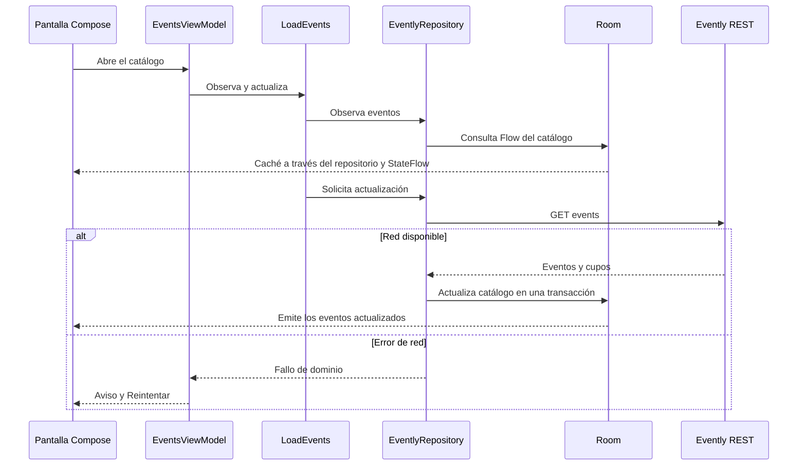
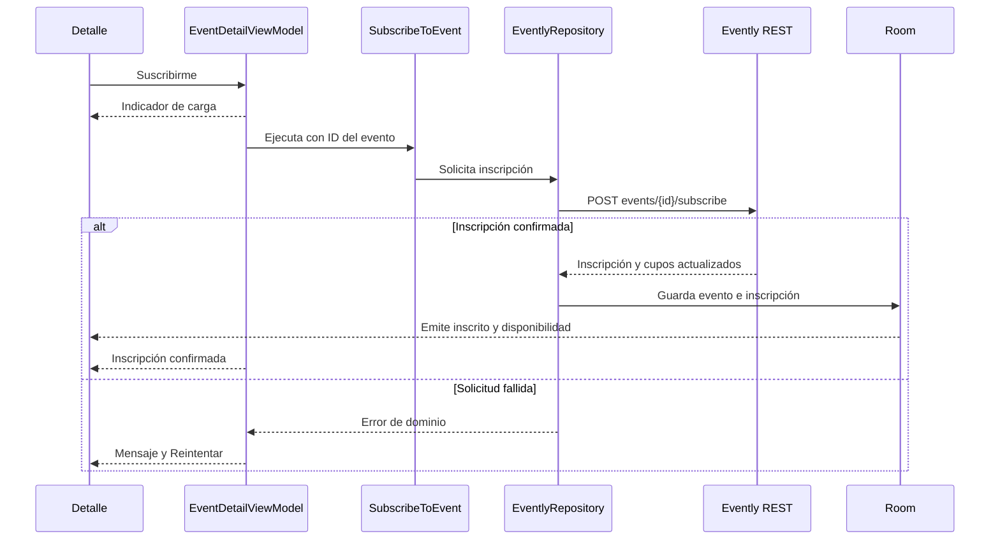

# Arquitectura de Evently Mobile

El cliente usa MVVM con arquitectura en capas y flujo unidireccional. La vista dispara acciones y observa estado. El ViewModel coordina esas acciones y expone `StateFlow`. Room es la fuente de los eventos y las suscripciones que aparecen en pantalla.

| Capa | Componentes | Responsabilidad |
| --- | --- | --- |
| `presentation` | Pantallas Compose, Navigation Compose, ViewModels, `UiState` | Entrada del usuario, navegación y estado de carga, éxito y error. |
| `domain` | `Event`, contratos `EventsRepository` y `SessionRepository`, casos `LoadEvents` y `SubscribeToEvent` | Datos y operaciones de la app independientes de Android, Retrofit y Room. |
| `data` | `EventlyRepository`, `EventlyModule`, APIs Retrofit, DAO de Room y `EncryptedSession` | Coordina HTTP, almacenamiento, transacciones, mapeo de errores y cifrado. |

Hilt inyecta los ViewModels y comparte las instancias de repositorio, base local y clientes HTTP a nivel de aplicación. Los ViewModels de pantalla viven con la entrada de navegación. El ViewModel de sesión vive con la Activity. Un cambio de configuración no ejecuta otra vez sus cargas iniciales.

## Catálogo y detalle

Al seleccionar un evento, Navigation Compose pasa el ID a `SavedStateHandle`. El detalle observa ese ID en Room y actualiza el contenido con la API. El estado de la inscripción se consulta y guarda en la misma base.

## Inscripción

## Referencias del curso

- Navegación y argumentos de ruta. [Módulo 1, clase 4](https://github.com/jorgesandovalflores/especializacion-mobile/tree/main/native-android/modulo-01/clase-04)
- MVVM y StateFlow. [Módulo 2, clase 1](https://github.com/jorgesandovalflores/especializacion-mobile/tree/main/native-android/modulo-02/clase-01)
- Hilt, Retrofit e inyección por constructor. [Módulo 2, clase 2](https://github.com/jorgesandovalflores/especializacion-mobile/tree/main/native-android/modulo-02/clase-02)
- Room como fuente local y patrón repositorio. [Módulo 3, clase 1](https://github.com/jorgesandovalflores/especializacion-mobile/tree/main/native-android/modulo-03/clase-01)
- Estados de UI y pruebas con fakes. [Módulo 3, clase 4](https://github.com/jorgesandovalflores/especializacion-mobile/tree/main/native-android/modulo-03/clase-04)
- Sesión cifrada, interceptor y renovación de tokens. [Ejemplo Android del módulo 5, clase 4](https://github.com/jorgesandovalflores/especializacion-mobile/tree/main/native-android/modulo-05/clase-04/android-app-taxi)
