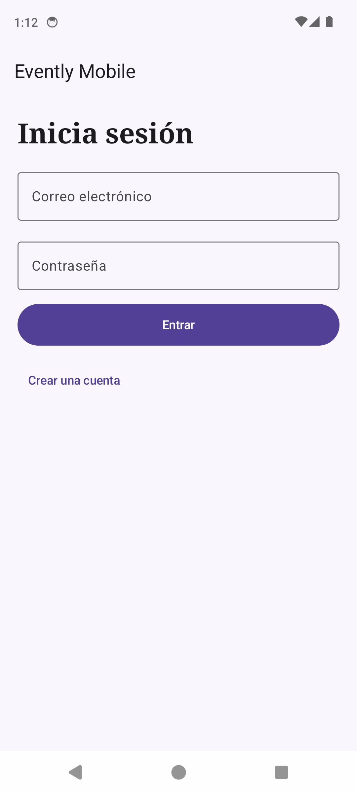
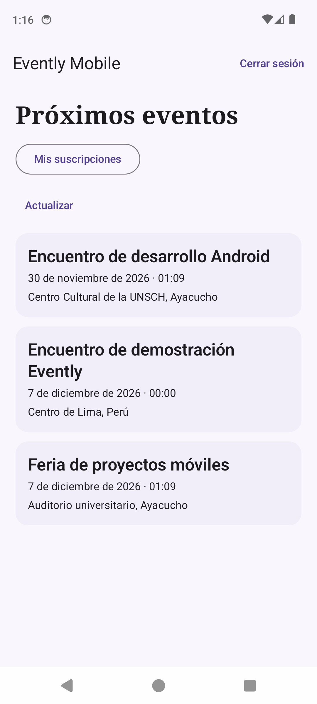
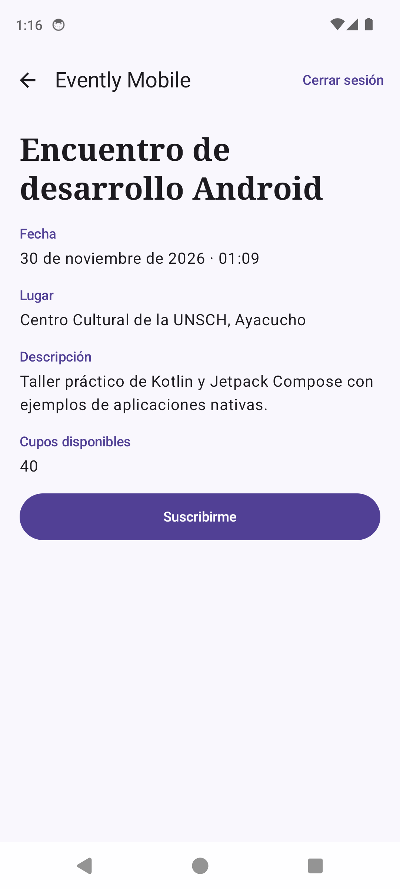
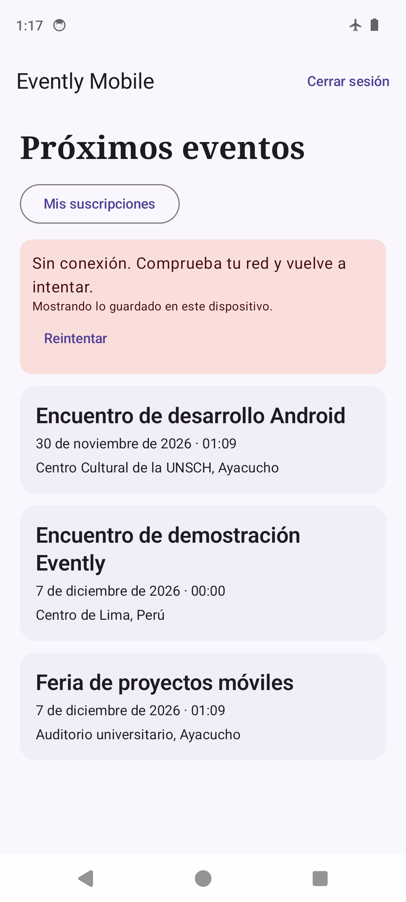

# Verificación y demostración

## Flujo para presentar

1. Abre la app e inicia sesión. El registro está disponible desde la misma pantalla.
2. Busca un evento en la lista de próximos eventos y abre su detalle. Muestra la disponibilidad.
3. Pulsa «Suscribirme» y espera la confirmación. La app muestra «Suscrito» y actualiza los cupos.
4. Vuelve al catálogo y abre «Mis suscripciones». Comprueba que figura el evento.
5. Desactiva la conexión del emulador y vuelve a abrir la app. Comprueba que se conserva la sesión local y que Room muestra el catálogo y las suscripciones junto al aviso de red.
6. Confirma el cierre de sesión. Debe volver al login y vaciar las dos tablas de Room.

## Pruebas unitarias

```powershell
.\gradlew.bat :app:testDebugUnitTest
```

`EventlyBasicTest` cubre la emisión de la caché y su reemplazo al sincronizar, la inscripción con validación de ID y la recuperación del ViewModel después de un fallo de red.

## Capturas del emulador

| Inicio de sesión | Catálogo | Detalle |
| --- | --- | --- |
|  |  |  |

| Inscripción confirmada | Mis suscripciones | Catálogo sin conexión |
| --- | --- | --- |
|  |  |  |
