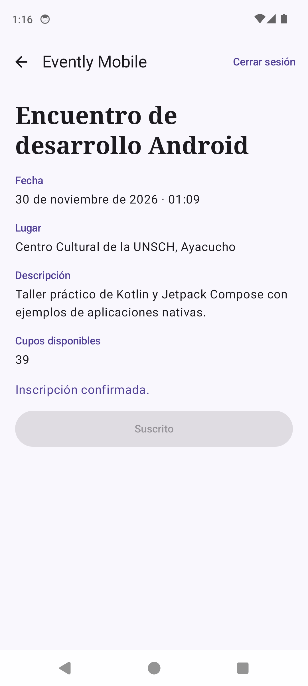
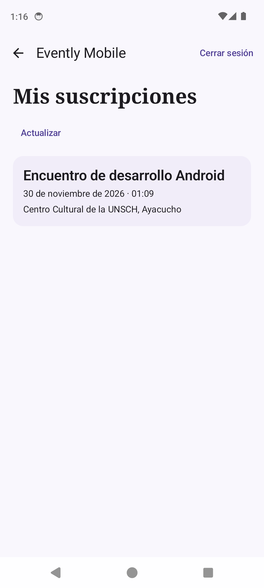

# Verificación y demostración

## Flujo para presentar

1. Abre la app e inicia sesión. El registro está disponible desde la misma pantalla.
2. Busca un evento en la lista de próximos eventos y abre su detalle. Muestra la disponibilidad.
3. Pulsa «Suscribirme» y espera la confirmación. La app muestra «Suscrito» y actualiza los cupos.
4. Vuelve al catálogo y abre «Mis suscripciones». Comprueba que figura el evento.
5. Desactiva la conexión del emulador y vuelve a abrir la app. Comprueba que se conserva la sesión local y que Room muestra el catálogo y las suscripciones junto al aviso de red.
6. Confirma el cierre de sesión. Debe volver al login y vaciar las dos tablas de Room.

## Pruebas unitarias

```powershell
.\gradlew.bat :app:testDebugUnitTest
```

`EventlyBasicTest` cubre la emisión de la caché y su reemplazo al sincronizar, la inscripción con validación de ID y la recuperación del ViewModel después de un fallo de red.

## Resultados de verificación

- El APK de depuración se instaló y ejecutó en un emulador con Android 14. Pasaron las tres pruebas unitarias.
- Se comprobó el registro, el inicio de sesión, la inscripción, la rotación y la lectura de Room en modo avión. Se inspeccionaron las dos tablas tras cerrar sesión sin red y ambas quedaron vacías.
- Con un token de acceso de corta duración se comprobó que Android renovó la sesión y cargó Mis suscripciones. La prueba de la API confirmó que dos solicitudes simultáneas para el último cupo solo permiten una inscripción.
- La revisión de alcance cubre EB-01 a EB-09 y los requisitos comunes de arquitectura, comportamiento, seguridad y entrega. La app Android usa REST y se entrega con APK de depuración y pruebas unitarias. El soporte Socket.IO del servidor y de la web pertenece a los componentes del curso.
- Al girar el teléfono a horizontal, la app mantuvo abierto el mismo evento. Los ViewModels están asociados a las entradas de navegación y la carga inicial se ejecuta en su inicialización.
- En un emulador actualizado desde el prototipo, se comprobó que su base de datos y sus preferencias antiguas seguían presentes antes de cerrar sesión. Después de confirmar el cierre en modo avión, se verificó que desaparecieran los archivos del prototipo y los tokens guardados. Las tablas `event` y `subscription` quedaron con cero filas.

## Capturas del emulador

| Inicio de sesión | Catálogo | Detalle |
| --- | --- | --- |
|  |  |  |

| Inscripción confirmada | Mis suscripciones | Catálogo sin conexión |
| --- | --- | --- |
|  |  |  |
