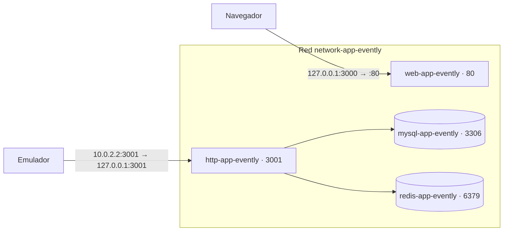
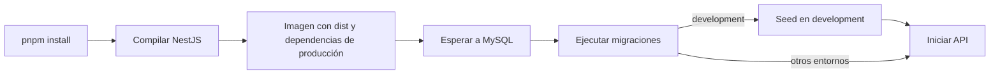

# Infraestructura Evently · Docker Compose

El entorno local inicia MySQL, Redis, la API REST y el contenedor web. Cada servicio tiene su archivo Compose y los cuatro comparten una red y un archivo `.env`. [Visión general](../README.md) · [Backend](../backend-evently/README.md)

## 1. Qué se levanta y cómo se conecta



| Servicio | Imagen | Equipo → contenedor | Datos |
| --- | --- | --- | --- |
| MySQL | `mysql:8.0.35` | `3306 → 3306` | Volumen `evently_mysql_volume`. |
| Redis | `redis:8.2-alpine` | `6379 → 6379` por defecto | Volumen `evently_redis_volume`, con AOF. |
| API REST | `http-app-evently:0.0.1` | `3001 → 3001` | Imagen construida desde `backend-evently`. |
| Web estática | `web-app-evently:0.0.1` | `3000 → 80` | Imagen construida desde `web-evently`. |

Los puertos se publican en `127.0.0.1`. La API accede a MySQL y Redis por nombre de contenedor y puerto interno. Si configuras `REDIS_PORT=6382`, cambia el puerto del equipo y la API sigue usando `redis-app-evently:6379`.

## 2. Archivos y variables

```text
infra-evently/
├── .env.example               Plantilla de parámetros locales
├── docker-compose.mysql.yml   MySQL, healthcheck y volumen
├── docker-compose.redis.yml   Redis, AOF y volumen
├── docker-compose.http.yml    API y comprobación de catálogo
├── docker-compose.web.yml     Web con Nginx
└── start-local.ps1            Generación de .env y arranque en Windows
```

| Variable en `.env` | Efecto |
| --- | --- |
| `PROJECT_NAME`, `NETWORK` | Identifican el proyecto Compose y la red externa compartida. |
| `MYSQL_DATABASE`, `MYSQL_ROOT_PASSWORD` | Base de datos y credencial usadas por MySQL y la API. |
| `HTTP_APP_PORT`, `HTTP_GLOBAL_PREFIX` | Puerto HTTP y prefijo de las rutas. |
| `HTTP_NODE_ENV` | El modo `development` activa los seeds al arrancar. |
| `HTTP_JWT_ACCESS_SECRET`, `HTTP_JWT_REFRESH_SECRET` | Claves de firma que recibe el backend. |
| `REDIS_PORT`, `WEB_APP_PORT` | Puertos del equipo para Redis y la web. |

El script crea `.env` si falta y genera las claves locales de MySQL y JWT. Para configurar el archivo sin iniciar contenedores, ejecuta `./start-local.ps1 -ConfigureOnly` desde esta carpeta. [Plantilla de configuración](.env.example) · [Script](start-local.ps1)

## 3. Imágenes y arranque de la API



La imagen de la web compila con Vite y entrega los archivos desde Nginx. La API incorpora un healthcheck que consulta el listado de eventos. [Dockerfile de la API](../backend-evently/Dockerfile) · [Dockerfile web](../web-evently/Dockerfile)

## 4. Levantar el entorno

Con Docker Desktop abierto, ejecuta desde la raíz del repositorio:

```powershell
& .\infra-evently\start-local.ps1
```

El script carga las variables, crea la red si falta y llama a Compose con `up -d --build --wait`. Los valores a continuación son los predeterminados.

| Acceso | URL |
| --- | --- |
| REST desde el equipo | `http://localhost:3001/api/` |
| REST desde Android en emulador | `http://10.0.2.2:3001/api/` |
| Swagger | `http://localhost:3001/api/docs` |
| Web estática | `http://localhost:3000/` |

[Catálogo REST](http://localhost:3001/api/events) · [Swagger local](http://localhost:3001/api/docs)

## 5. Actualizar, revisar y detener

Ejecuta nuevamente el script para reconstruir las imágenes con los cambios. Desde `infra-evently`, puedes consultar o detener el entorno con estos comandos si mantienes `PROJECT_NAME=app-evently`:

```powershell
$composeFiles = @(
    '-f', 'docker-compose.mysql.yml',
    '-f', 'docker-compose.redis.yml',
    '-f', 'docker-compose.http.yml',
    '-f', 'docker-compose.web.yml'
)
docker compose -p app-evently @composeFiles ps
docker compose -p app-evently @composeFiles logs http
docker compose -p app-evently @composeFiles down
```

Los volúmenes nombrados conservan los datos al ejecutar `down`.

## 6. Diagnóstico

| Síntoma | Qué comprobar |
| --- | --- |
| Redis no puede publicar su puerto | Usa un puerto disponible en `REDIS_PORT`. El puerto interno es 6379. |
| La API no está saludable | Revisa el healthcheck de MySQL y los logs de la API. |
| La ruta `/api/events` en el puerto 3000 devuelve HTML | El puerto 3000 sirve la SPA. El catálogo REST está en el puerto 3001. |
| Android conecta pero el catálogo muestra un error | El JSON actual omite `availableSpots`. [Contrato Android](../docs/README.md#32-contrato-rest) |
