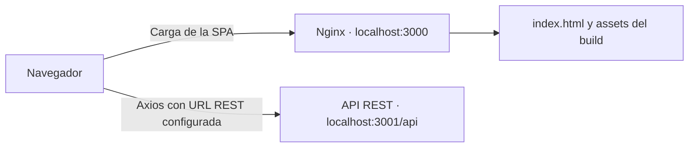

# Web Evently · Cliente del curso

Cliente Vue del repositorio. Esta guía describe las pantallas del asistente, que consultan la API Evently mediante Axios. [Backend](../backend-evently/README.md) · [Despliegue local](../infra-evently/README.md)

## Stack

| Tecnología | Uso |
| --- | --- |
| Vue 3.5 y TypeScript 5.8 | Componentes, vistas y tipos de la API. |
| Vite 7 y `vue-tsc` | Servidor de desarrollo, chequeo de tipos y compilación. |
| Vue Router 4 y Pinia 3 | Navegación, control de acceso, sesión y avisos. |
| Axios 1, Tailwind CSS 4 y Day.js 1 | REST, estilos y formato de fechas. |
| Nginx 1.27 | Archivos estáticos en Docker y rutas de Vue Router en modo history. |

## Cómo correrlo en local

Inicia la API en el puerto 3001. En PowerShell, desde `web-evently` y con Node 22 y pnpm 9 disponibles, ejecuta:

```powershell
pnpm install --frozen-lockfile
$env:VITE_API_BASE_URL = 'http://localhost:3001/api'
pnpm dev
```

Vite sirve la web en `http://localhost:5173` por defecto. Cambia `VITE_API_BASE_URL` antes de iniciar Vite o compilar. `pnpm build` ejecuta `vue-tsc -b` y genera `dist/`. `pnpm preview` sirve el resultado de esa compilación.

[Configuración Vite](vite.config.ts) · [Cliente HTTP](src/api/http.ts)

## Con Docker

El Dockerfile compila con Node y pnpm y copia `dist/` a Nginx. El navegador abre el sitio en el puerto 3000 del equipo. Nginx escucha en el puerto 80 del contenedor.



**Estado de la imagen incluida.** Vite incorpora la URL de la API al compilar. El Dockerfile actual usa el respaldo `/api` si esa variable está ausente durante el build. Nginx entrega `index.html` al recibir esa ruta porque su configuración sirve la SPA. Se comprobó que `http://localhost:3000/api/events` devuelve HTML. Para consultar datos desde el navegador en desarrollo, usa la configuración de Vite de arriba.

[Dockerfile](Dockerfile) · [Configuración Nginx](nginx/default.conf)

## Estructura de carpetas

```text
web-evently/
├── Dockerfile
├── nginx/default.conf
└── src/
    ├── main.ts          Inicio de Vue, Pinia y el router
    ├── api/             Axios y funciones REST
    ├── components/      Barra, tarjetas, modal y avisos
    ├── router/          Rutas y guard de autorización
    ├── stores/          Sesión y avisos
    ├── types/           Tipos del contrato JSON
    └── views/           Pantallas
```

## Pantallas del asistente

| Ruta web | Pantalla | Peticiones REST principales |
| --- | --- | --- |
| `/` | Próximos eventos | `GET /events` |
| `/events/:id` | Detalle e inscripción | `GET /events/{id}`, `POST /events/{id}/subscribe` |
| `/login` | Ingreso | `POST /auth/login` |
| `/register` | Registro | `POST /auth/register` |
| `/me/subscriptions` | Mis suscripciones con sesión | `GET /me/subscriptions` |

[Definición de rutas y roles](src/router/index.ts)

## Cómo funciona la sesión

Pinia guarda el usuario y los tokens en `localStorage` bajo la clave `auth`. El guard de Vue Router recupera esos datos cuando prepara una ruta. Si la ruta requiere sesión, redirige al login. El interceptor de Axios agrega el access token cuando está disponible.

El interceptor contiene un intento de renovación ante HTTP 401. En el código actual puede sobrescribir el encabezado Bearer de esa petición con el access token, por lo que la renovación web no está garantizada. [Store de sesión](src/stores/auth.ts) · [Interceptor HTTP](src/api/http.ts)
